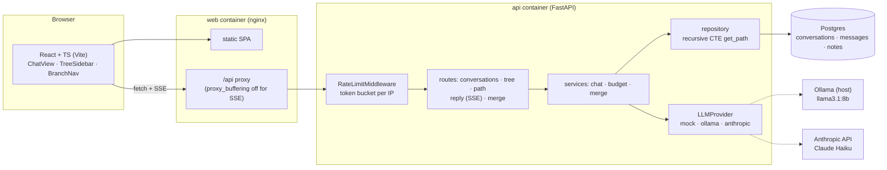

# Branch Chat

[](https://github.com/b1luu/branch-chat/actions/workflows/ci.yml)

**Ask side questions without losing your main thread.**

When an AI answer confuses you, the usual move is a new tab, re-explaining the context, and losing your place. Branch Chat turns a conversation into a **tree**: highlight anything in an answer, click **Ask about this**, and explore it on a side branch that sees the full parent context but none of its siblings. When you're done, jump **Back to main thread**, or **Merge back** a short summary of what you learned so the main thread knows it too.

> **Screenshot / GIF placeholder**: branching off a highlighted quote, then merging back.
<!-- TODO: add docs/screenshot.png (or a GIF) once the UI is styled, and embed it here. -->

## Features

- **Tree of chats**: reply to any message, not just the last one; every fork is a branch.
- **Quote branches**: select text in an assistant reply → *Ask about this* → the quote is pinned into the new branch's prompt.
- **Context isolation**: a branch's prompt is exactly its root→node path. Siblings never leak into each other.
- **Navigation**: collapsible tree sidebar, branch breadcrumb, *Back to main thread* (lands on the newest turn of the branch you came from).
- **Merge back**: summarize a side branch into a note on the message it forked from; descendants of that message get the note in their context.
- **Streaming** assistant replies over Server-Sent Events.
- **Cost guards**: `max_tokens` cap, context budget with cached ancestor summarization, per-IP rate limiting, and Anthropic prompt caching on the shared ancestor prefix.
- **Pluggable LLMs**: local Ollama, Anthropic Claude Haiku, or a deterministic mock (used by every test).

## Architecture



A reply goes: `POST /api/messages/{id}/reply` → user node committed → root→node path loaded with one recursive CTE (plus merge notes) → trimmed to the context budget → streamed from the provider as `token` events → assistant node persisted → `done`.

## Quick start (Docker)

```bash
cp .env.example .env            # optional; defaults to the mock LLM
docker compose up --build       # Postgres + API + web
open http://localhost:8080
```

The API container runs `alembic upgrade head` on start (after waiting for Postgres), so there's no manual migration step. Verify the whole stack with:

```bash
python scripts/smoke_test.py --compose   # build, up, smoke test, down -v
```

### With a local model (Ollama)

```bash
ollama pull llama3.1:8b
# in .env:
LLM_PROVIDER=ollama
```

The API container reaches Ollama on your machine through `host.docker.internal` (override with `OLLAMA_BASE_URL_DOCKER`). Make sure Ollama listens on an address Docker can reach (`OLLAMA_HOST=0.0.0.0` on Linux).

### With Claude Haiku

```bash
# in .env (never commit it):
LLM_PROVIDER=anthropic
ANTHROPIC_API_KEY=sk-ant-...
ANTHROPIC_MODEL=claude-haiku-5-5
```

## Local development

Backend (Python 3.12):

```bash
cd backend
python -m venv .venv && source .venv/bin/activate
pip install -e ".[dev]"
alembic upgrade head                      # SQLite file by default (DATABASE_URL to change)
LLM_PROVIDER=mock uvicorn app.main:app --reload
```

Frontend (Node 22):

```bash
cd frontend
npm ci
npm run dev        # http://localhost:5173, proxies /api to :8000 (BACKEND_URL to change)
```

## Tests

| Tier | Where | Command |
| --- | --- | --- |
| Backend (mock LLM, SQLite; Postgres too if `TEST_POSTGRES_URL` is set) | everywhere | `cd backend && ruff check . && pytest -q` |
| Frontend | everywhere | `cd frontend && npm run lint && npm test -- --run && npm run build` |
| Docker smoke test | CI, or any machine with Docker | `python scripts/smoke_test.py --compose` |
| Real model (Ollama) | a machine with Ollama | `python scripts/local_test.py` |

Tests never call real networks or LLMs: HTTP providers are tested with mocked transports (respx), and the `ollama`-marked integration tests auto-skip when Ollama isn't reachable. Real-model tests assert structure (streaming, persistence, context isolation, quotes, merge notes), never exact wording. CI (GitHub Actions) runs the backend suite against both SQLite and a Postgres service, the frontend checks, then builds the images and runs the smoke test.

## Configuration

All settings are environment variables; see [`.env.example`](.env.example).

| Variable | Default | Purpose |
| --- | --- | --- |
| `LLM_PROVIDER` | `mock` | `mock`, `ollama` or `anthropic` |
| `LLM_MAX_TOKENS` | `1024` | cap on each reply |
| `CONTEXT_TOKEN_BUDGET` | `60000` | estimated tokens before old ancestors get summarized |
| `CONTEXT_SUMMARY_MAX_TOKENS` | `500` | cap on that summary |
| `RATE_LIMIT_PER_MINUTE` / `RATE_LIMIT_BURST` | `20` / `10` | token bucket on reply + merge, per IP |
| `RATE_LIMIT_TRUST_PROXY` | `false` (`true` in compose) | key on X-Forwarded-For's last hop |
| `ANTHROPIC_PROMPT_CACHE` | `true` | cache-control breakpoints on the ancestor prefix |
| `OLLAMA_BASE_URL` / `OLLAMA_MODEL` | `http://localhost:11434/v1` / `llama3.1:8b` | Ollama's OpenAI-compatible endpoint |
| `DATABASE_URL` | SQLite file (Postgres in compose) | SQLAlchemy URL |

## Design decisions

**Tree model (adjacency list).** Every message has a nullable `parent_id`; a conversation is a tree rooted at a system message. A *branch* is any child of a message that already has a child. The oldest child continues a branch and later siblings start side branches, so "main thread" vs. "side branch" is derived from the tree alone: no extra state, and it survives reloads. Adjacency lists make inserts O(1) and keep branching trivial; the cost is reading ancestors, which the CTE handles.

**Recursive CTE for context.** The LLM context for a node is its root→node path, fetched in one query that walks *up* `parent_id` links:

```sql
WITH RECURSIVE path(id, parent_id, depth) AS (
    SELECT id, parent_id, 0 FROM messages WHERE id = :message_id
    UNION ALL
    SELECT m.id, m.parent_id, path.depth + 1
    FROM messages m JOIN path ON m.id = path.parent_id
)
SELECT messages.* FROM messages JOIN path USING (id) ORDER BY depth DESC;
```

It's O(depth) primary-key lookups regardless of tree size, standard SQL that runs on SQLite (tests) and Postgres (prod), and by construction never includes siblings or cousins, which is what keeps branches isolated.

**Streaming over SSE.** `fetch` + `ReadableStream` with a small hand-written parser instead of `EventSource`, because `EventSource` can't POST a JSON body. The user node is committed before streaming starts (so 404s etc. get a real status code), and the assistant node is written only when the stream completes, so an abandoned generation leaves no half-written reply. Rate limiting is pure ASGI middleware so SSE bodies pass through untouched, and nginx runs with `proxy_buffering off`.

**Prompt caching.** Sibling branches replying to the same message share an identical prefix. The Anthropic provider puts `cache_control` breakpoints at the end of the system prompt, the end of the ancestor prefix, and on the newest user turn, so branching off a long thread is a cache hit instead of re-paying for the whole history. Merge notes are inlined at their position rather than lifted into `system`, which would change the first bytes of every later prompt and bust the cache.

**Context budget.** Token counts are estimated (≈ chars/4 + per-message overhead; no tokenizer dependency, provider-agnostic). Over budget, the oldest ancestors are condensed into one summary message by the same provider. The cut point is rounded to fixed steps so the summarized prefix stays stable across replies, and summaries are cached by content hash, so most over-budget replies cost no extra LLM call and sibling branches share a summary. If summarization fails, old turns are dropped with a marker instead of failing the reply.

**Merge back.** A side branch (from its fork point to the leaf) is summarized into a `note` attached to the fork-origin message. The note renders inline in the parent thread and is injected into the context of that message's descendants, but not into the branch it summarizes (which already has those turns). Merging is idempotent per leaf: messages are immutable, so a repeat merge of the same leaf returns the existing note (`200`, no LLM call), and a unique index on `notes.source_leaf_id` makes a double-submitted merge race-safe (the loser returns the winner's note).

**Rate limiting.** Per-IP token bucket (burst + continuous refill) on the two endpoints that cost money: reply and merge. Rejected requests get `429` + `Retry-After` and never reach the route, so no orphan user node is created. Behind the web proxy, the limiter keys on the *last* X-Forwarded-For hop (the one our proxy added; the first is client-controlled).

## Project layout

```
backend/   FastAPI app (app/api, app/db, app/llm, app/services), Alembic, tests
frontend/  React + TS app (Vite, Vitest), nginx config for the web image
scripts/   smoke_test.py (docker stack), local_test.py (real-model tests)
```

Built in autonomous sprints: see [`SPEC.md`](SPEC.md), [`BACKLOG.md`](BACKLOG.md) and the log in [`PROGRESS.md`](PROGRESS.md).
